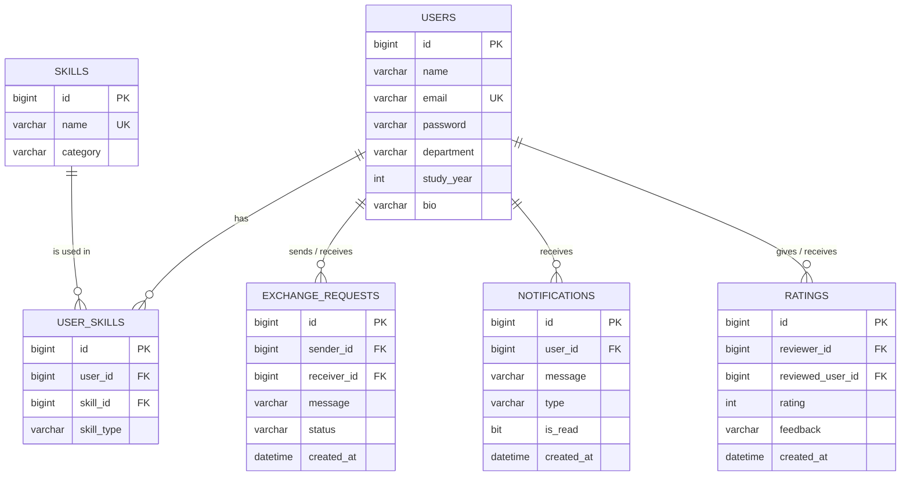

# Database Documentation

**Database:** `student_skill_exchange` (MySQL 8)

Tables are created automatically by Hibernate when the backend starts, using the entity classes and the setting `spring.jpa.hibernate.ddl-auto=update`.

## Entity Relationship Diagram

## Tables

### 1. users

Stores student account and profile details.

| Column | Type | Description |
|---|---|---|
| id | BIGINT | Primary key |
| name | VARCHAR(255) | Student name |
| email | VARCHAR(255) | Unique email |
| password | VARCHAR(255) | BCrypt password hash |
| department | VARCHAR(255) | Department, such as CSE or ECE |
| study_year | INT | Study year from 1 to 4 |
| bio | VARCHAR(500) | Optional student introduction |

### 2. skills

Stores each skill once.

| Column | Type | Description |
|---|---|---|
| id | BIGINT | Primary key |
| name | VARCHAR(255) | Unique skill name |
| category | ENUM | Skill category |

Categories include PROGRAMMING, WEB_DEVELOPMENT, DATABASE, DATA_SCIENCE, AI_ML, DESIGN, COMMUNICATION and OTHER.

### 3. user_skills

Connects students with the skills they teach or want to learn.

| Column | Type | Description |
|---|---|---|
| id | BIGINT | Primary key |
| user_id | BIGINT | References users.id |
| skill_id | BIGINT | References skills.id |
| skill_type | ENUM | TEACH or LEARN |

A student cannot add the same skill twice with the same type.

### 4. exchange_requests

Stores requests to exchange skills.

| Column | Type | Description |
|---|---|---|
| id | BIGINT | Primary key |
| sender_id | BIGINT | Student sending the request |
| receiver_id | BIGINT | Student receiving the request |
| message | VARCHAR(500) | Request message |
| status | ENUM | PENDING, ACCEPTED or REJECTED |
| created_at | DATETIME | Date and time of request |

### 5. notifications

Stores notifications sent to students.

| Column | Type | Description |
|---|---|---|
| id | BIGINT | Primary key |
| user_id | BIGINT | Student receiving the notification |
| message | VARCHAR(500) | Notification text |
| type | ENUM | Notification category |
| is_read | BIT | 0 means unread; 1 means read |
| created_at | DATETIME | Creation date and time |

### 6. ratings

Stores ratings and feedback between students.

| Column | Type | Description |
|---|---|---|
| id | BIGINT | Primary key |
| reviewer_id | BIGINT | Student giving the rating |
| reviewed_user_id | BIGINT | Student receiving the rating |
| rating | INT | Rating from 1 to 5 |
| feedback | VARCHAR(500) | Optional feedback |
| created_at | DATETIME | Date and time of rating |

## Design Decisions

- Skills are stored once and linked to students through user_skills.
- An accepted exchange request represents a connection, avoiding a separate connections table.
- Match scores and average ratings are calculated when needed.
- study_year is used instead of year to avoid the MySQL YEAR keyword.
- Enum values represent fixed choices, such as TEACH, LEARN, PENDING and ACCEPTED.

## Business Rules

- Email addresses must be unique.
- Passwords must contain at least 6 characters.
- Students cannot send exchange requests to themselves.
- Only the receiver can accept or reject a pending request.
- Ratings are allowed only between connected students, once per student pair.
